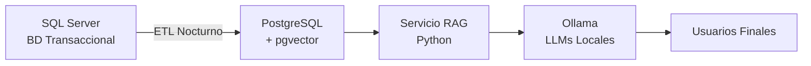
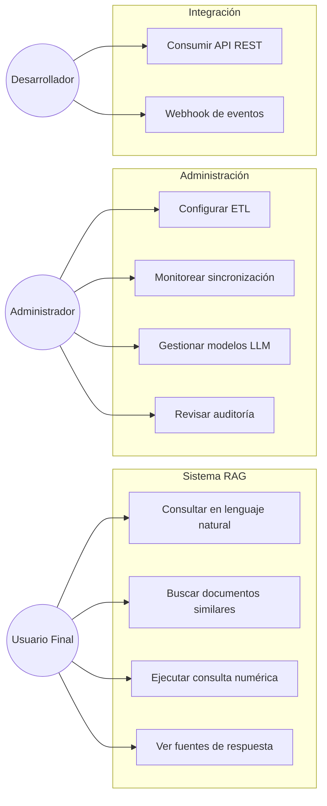

# 📋 ARTEFACTO 1: Software Requirements Specification (SRS)

## Sistema RAG On-Premise para Consultas Semánticas

---

# Documento de Especificación de Requisitos de Software (SRS)

**Proyecto:** Sistema de Consultas Semánticas y RAG On-Premise
**Versión:** 1.0
**Fecha:** 01 de Octubre de 2026
**Estado:** Borrador inicial
**Autor:** Equipo de Arquitectura

---

## Tabla de Contenidos

1. [Introducción](#1-introducción)
2. [Descripción General](#2-descripción-general)
3. [Requisitos Específicos](#3-requisitos-específicos)
4. [Requisitos No Funcionales](#4-requisitos-no-funcionales)
5. [Casos de Uso](#5-casos-de-uso)
6. [Reglas de Negocio](#6-reglas-de-negocio)
7. [Requisitos de Interfaz](#7-requisitos-de-interfaz)
8. [Glosario](#8-glosario)

---

## 1. Introducción

### 1.1 Propósito

Este documento define los requisitos funcionales y no funcionales del **Sistema de Consultas Semánticas y RAG (Retrieval-Augmented Generation) On-Premise**, el cual permitirá a los usuarios realizar consultas en lenguaje natural sobre la información almacenada en SQL Server, utilizando modelos de IA ejecutados localmente.

### 1.2 Alcance

El sistema habilitará:

- Sincronización nocturna de datos desde SQL Server hacia PostgreSQL con capacidades vectoriales.
- Búsqueda semántica sobre datos estructurados (tablas `socios` y `créditos`).
- Generación de respuestas en lenguaje natural mediante LLMs locales.
- Búsqueda híbrida (semántica + Text-to-SQL) para cubrir distintos tipos de consultas.
- Exposición de la funcionalidad vía API REST.

### 1.3 Definiciones, Acrónimos y Abreviaturas


| Término       | Definición                                                                                                      |
| -------------- | ---------------------------------------------------------------------------------------------------------------- |
| **RAG**        | Retrieval-Augmented Generation. Técnica que combina recuperación de documentos con generación por LLM.        |
| **LLM**        | Large Language Model. Modelo de lenguaje de gran tamaño.                                                        |
| **Embedding**  | Representación vectorial numérica de un texto.                                                                 |
| **pgvector**   | Extensión de PostgreSQL para almacenamiento y búsqueda de vectores.                                            |
| **ETL**        | Extract, Transform, Load. Proceso de extracción, transformación y carga de datos.                              |
| **CDC**        | Change Data Capture. Captura de cambios en bases de datos.                                                       |
| **HNSW**       | Hierarchical Navigable Small World. Algoritmo de indexación para búsqueda aproximada de vecinos más cercanos. |
| **On-Premise** | Infraestructura localizada físicamente en las instalaciones del cliente.                                        |

### 1.4 Referencias

- IEEE 830-1998: Recommended Practice for Software Requirements Specifications.
- Documentación oficial de PostgreSQL y pgvector.
- Documentación de Ollama para modelos locales.

---

## 2. Descripción General

### 2.1 Perspectiva del Producto

El sistema opera como una **capa inteligente satélite** sobre la base de datos transaccional SQL Server existente. No modifica la BD origen, sino que consume sus datos para proveer capacidades de IA.



### 2.2 Funciones del Producto (Resumen)


| ID   | Función                                     | Prioridad |
| ---- | -------------------------------------------- | --------- |
| F-01 | Sincronización nocturna de datos            | Alta      |
| F-02 | Vectorización automática de registros      | Alta      |
| F-03 | Búsqueda semántica por similitud coseno    | Alta      |
| F-04 | Búsqueda híbrida (semántica + texto)      | Media     |
| F-05 | Generación de respuestas con LLM            | Alta      |
| F-06 | API REST para consultas                      | Alta      |
| F-07 | Text-to-SQL para consultas numéricas        | Media     |
| F-08 | Clasificador automático de tipo de consulta | Media     |
| F-09 | Auditoría de consultas y respuestas         | Baja      |

### 2.3 Características de los Usuarios


| Rol               | Descripción                                        | Privilegios                                   |
| ----------------- | --------------------------------------------------- | --------------------------------------------- |
| **Usuario Final** | Analista de negocio, ejecutivo, oficial de crédito | Consultar vía API o UI                       |
| **Administrador** | TI / DBA                                            | Configurar ETL, gestionar modelos, monitorear |
| **Desarrollador** | Integración con otros sistemas                     | Consumir API REST                             |

### 2.4 Restricciones Generales

- **Infraestructura:** Todo el sistema debe ejecutarse **on-premise**. No se permite envío de datos a servicios en la nube.
- **Privacidad:** Los datos de socios y créditos son sensibles (datos personales y financieros).
- **Compatibilidad:** SQL Server 2019+ como fuente de datos.
- **Horario de ETL:** La sincronización debe realizarse en horario nocturno para no impactar la operación.

### 2.5 Suposiciones y Dependencias

- Se cuenta con un servidor con GPU (o CPU de alto rendimiento) para ejecutar los modelos localmente.
- SQL Server tiene habilitado el acceso ODBC para extracción.
- Existe una ventana de mantenimiento nocturna de al menos 4 horas.
- Los modelos LLM requeridos están disponibles en el repositorio de Ollama.

---

## 3. Requisitos Específicos

### 3.1 Requisitos Funcionales

#### RF-01: Sincronización Nocturna de Datos


| Campo                        | Descripción                                                                                                                                                               |
| ---------------------------- | -------------------------------------------------------------------------------------------------------------------------------------------------------------------------- |
| **Prioridad**                | Alta                                                                                                                                                                       |
| **Descripción**             | El sistema debe extraer diariamente los datos de las tablas`socios` y `créditos` desde SQL Server y cargarlos en PostgreSQL.                                              |
| **Entrada**                  | Datos de SQL Server (tablas`socios`, `créditos`).                                                                                                                         |
| **Procesamiento**            | JOIN de tablas, generación de texto enriquecido, vectorización, UPSERT en PostgreSQL.                                                                                    |
| **Salida**                   | Registros actualizados en tabla`registros_rag` de PostgreSQL.                                                                                                              |
| **Frecuencia**               | Diaria, ejecutada a las 02:00 AM.                                                                                                                                          |
| **Criterios de aceptación** | - Todos los registros nuevos/actualizados se reflejan en PostgreSQL antes de las 06:00 AM.<br>- No se duplican registros existentes.<br>- Se registran logs de ejecución. |

#### RF-02: Vectorización Automática


| Campo                        | Descripción                                                                                                                                                                                                   |
| ---------------------------- | -------------------------------------------------------------------------------------------------------------------------------------------------------------------------------------------------------------- |
| **Prioridad**                | Alta                                                                                                                                                                                                           |
| **Descripción**             | Cada registro sincronizado debe convertirse en un texto enriquecido y luego en un vector de 1024 dimensiones usando el modelo`nomic-embed-text` vía Ollama.                                                   |
| **Criterios de aceptación** | - El vector generado tiene 1024 dimensiones.<br>- El texto enriquecido incluye contexto semántico (mapeo de códigos a descripciones).<br>- Se preserva la trazabilidad con los IDs originales de SQL Server. |

#### RF-03: Búsqueda Semántica


| Campo                        | Descripción                                                                                                                       |
| ---------------------------- | ---------------------------------------------------------------------------------------------------------------------------------- |
| **Prioridad**                | Alta                                                                                                                               |
| **Descripción**             | El sistema debe permitir buscar registros por similitud semántica usando distancia coseno sobre los vectores almacenados.         |
| **Parámetros**              | -`pregunta` (texto)<br>- `top_k` (entero, default 5)<br>- `umbral_similitud` (float, default 0.7)<br>- `tipo_documento` (opcional) |
| **Salida**                   | Lista de registros ordenados por similitud descendente.                                                                            |
| **Criterios de aceptación** | - Respuesta en menos de 500ms (búsqueda vectorial).<br>- Los resultados son semánticamente relevantes a la consulta.             |

#### RF-04: Búsqueda Híbrida


| Campo                        | Descripción                                                                                                                |
| ---------------------------- | --------------------------------------------------------------------------------------------------------------------------- |
| **Prioridad**                | Media                                                                                                                       |
| **Descripción**             | Combinar búsqueda semántica (peso 70%) con búsqueda de texto completo PostgreSQL FTS (peso 30%) para mejorar precisión. |
| **Criterios de aceptación** | - Los resultados combinan relevancia semántica y coincidencia textual.<br>- Funciona correctamente con texto en español.  |

#### RF-05: Generación de Respuestas con LLM


| Campo                        | Descripción                                                                                                                                                                         |
| ---------------------------- | ------------------------------------------------------------------------------------------------------------------------------------------------------------------------------------ |
| **Prioridad**                | Alta                                                                                                                                                                                 |
| **Descripción**             | El sistema debe generar respuestas en lenguaje natural usando un LLM local (ej.`llama3:8b` o `qwen2.5:7b`) basado en el contexto recuperado.                                         |
| **Reglas**                   | - El LLM debe responder**solo** con base en el contexto recuperado.<br>- Si no hay información suficiente, debe indicar que no puede responder.<br>- No debe inventar información. |
| **Criterios de aceptación** | - Respuesta coherente y en español.<br>- Tiempo de respuesta menor a 15 segundos.<br>- Se incluyen referencias a los documentos usados.                                             |

#### RF-06: API REST


| Campo            | Descripción                                                                 |
| ---------------- | ---------------------------------------------------------------------------- |
| **Prioridad**    | Alta                                                                         |
| **Descripción** | Exponer la funcionalidad mediante una API REST con los siguientes endpoints: |


| Método | Endpoint     | Descripción                       |
| ------- | ------------ | ---------------------------------- |
| POST    | `/consultar` | Realiza una consulta RAG completa  |
| POST    | `/buscar`    | Solo búsqueda vectorial (sin LLM) |
| POST    | `/sql`       | Ejecuta Text-to-SQL                |
| GET     | `/health`    | Health check                       |
| GET     | `/metrics`   | Métricas del sistema              |

#### RF-07: Text-to-SQL


| Campo                        | Descripción                                                                                                                                                  |
| ---------------------------- | ------------------------------------------------------------------------------------------------------------------------------------------------------------- |
| **Prioridad**                | Media                                                                                                                                                         |
| **Descripción**             | Para consultas numéricas/exactas, el sistema debe traducir la pregunta a SQL y ejecutarla directamente contra SQL Server.                                    |
| **Ejemplos**                 | - "¿Cuántos créditos hay en Querétaro?"<br>- "¿Cuál es el monto total de créditos vigentes?"                                                           |
| **Criterios de aceptación** | - SQL generado es válido y seguro (sin inyección SQL).<br>- Solo se permiten operaciones SELECT (lectura).<br>- Se muestra el SQL generado para auditoría. |

#### RF-08: Clasificador de Tipo de Consulta


| Campo                        | Descripción                                                                                                                                    |
| ---------------------------- | ----------------------------------------------------------------------------------------------------------------------------------------------- |
| **Prioridad**                | Media                                                                                                                                           |
| **Descripción**             | El sistema debe clasificar automáticamente la pregunta del usuario para decidir si usar RAG o Text-to-SQL.                                     |
| **Criterios de aceptación** | - Precisión de clasificación > 85%.<br>- Palabras clave como "cuántos", "total", "suma" → Text-to-SQL.<br>- Preguntas exploratorias → RAG. |

#### RF-09: Auditoría


| Campo                 | Descripción                                                                                                              |
| --------------------- | ------------------------------------------------------------------------------------------------------------------------- |
| **Prioridad**         | Baja                                                                                                                      |
| **Descripción**      | Registrar todas las consultas realizadas, documentos recuperados y respuestas generadas.                                  |
| **Datos a registrar** | - Timestamp<br>- Usuario<br>- Pregunta<br>- Documentos recuperados (IDs)<br>- Respuesta generada<br>- Tiempo de respuesta |

---

### 3.2 Requisitos de Sincronización (Detalle)

#### RF-10: Detección de Cambios


| Campo                        | Descripción                                                                                                                         |
| ---------------------------- | ------------------------------------------------------------------------------------------------------------------------------------ |
| **Prioridad**                | Alta                                                                                                                                 |
| **Descripción**             | El ETL debe detectar solo los registros nuevos o modificados desde la última ejecución usando una columna`ModifiedDate` o similar. |
| **Criterios de aceptación** | - Solo se procesan registros con`ModifiedDate > última_ejecución`.<br>- Se reduce el tiempo de ETL en ejecuciones incrementales.   |

#### RF-11: Manejo de Errores en ETL


| Campo                        | Descripción                                                                                                                                     |
| ---------------------------- | ------------------------------------------------------------------------------------------------------------------------------------------------ |
| **Prioridad**                | Alta                                                                                                                                             |
| **Descripción**             | El ETL debe manejar errores de forma transaccional: si falla, no debe dejar datos inconsistentes.                                                |
| **Criterios de aceptación** | - Se envía notificación al administrador en caso de fallo.<br>- Se genera log detallado del error.<br>- Los datos previos permanecen intactos. |

---

## 4. Requisitos No Funcionales

### 4.1 Rendimiento


| ID     | Requisito                          | Métrica                          |
| ------ | ---------------------------------- | --------------------------------- |
| RNF-01 | Tiempo de búsqueda vectorial      | < 500 ms (p95)                    |
| RNF-02 | Tiempo de generación de embedding | < 300 ms                          |
| RNF-03 | Tiempo total de respuesta RAG      | < 15 segundos                     |
| RNF-04 | Tiempo de ETL nocturno             | < 2 horas para 100,000 registros  |
| RNF-05 | Concurrencia soportada             | Mínimo 50 consultas simultáneas |

### 4.2 Seguridad


| ID     | Requisito                     | Descripción                                                               |
| ------ | ----------------------------- | -------------------------------------------------------------------------- |
| RNF-06 | Confidencialidad              | Todos los datos permanecen on-premise. No se envían a servicios externos. |
| RNF-07 | Autenticación API            | La API REST debe requerir autenticación (JWT o API Key).                  |
| RNF-08 | Autorización                 | Control de acceso basado en roles (RBAC).                                  |
| RNF-09 | Cifrado en tránsito          | TLS 1.3 para todas las comunicaciones.                                     |
| RNF-10 | Cifrado en reposo             | Datos sensibles cifrados en PostgreSQL.                                    |
| RNF-11 | Auditoría de acceso          | Logs de todas las consultas y accesos.                                     |
| RNF-12 | Prevención de inyección SQL | Validación y sanitización estricta en Text-to-SQL.                       |

### 4.3 Disponibilidad


| ID     | Requisito      | Descripción                                                                             |
| ------ | -------------- | ---------------------------------------------------------------------------------------- |
| RNF-13 | Disponibilidad | 99.5% en horario laboral (L-V 7:00-20:00).                                               |
| RNF-14 | Recuperación  | RTO < 4 horas, RPO < 24 horas.                                                           |
| RNF-15 | Resiliencia    | Si Ollama falla, el sistema debe degradarse gracefully (solo búsqueda sin generación). |

### 4.4 Escalabilidad


| ID     | Requisito        | Descripción                                                                         |
| ------ | ---------------- | ------------------------------------------------------------------------------------ |
| RNF-16 | Volumen de datos | Soportar hasta 10 millones de vectores en PostgreSQL.                                |
| RNF-17 | Crecimiento      | Arquitectura preparada para agregar nuevas tablas de SQL Server sin cambios mayores. |

### 4.5 Mantenibilidad


| ID     | Requisito              | Descripción                                                                       |
| ------ | ---------------------- | ---------------------------------------------------------------------------------- |
| RNF-18 | Configuración externa | Modelos, umbrales y parámetros deben ser configurables vía variables de entorno. |
| RNF-19 | Logging                | Logs estructurados (JSON) con niveles DEBUG, INFO, WARN, ERROR.                    |
| RNF-20 | Monitoreo              | Métricas exportables a Prometheus/Grafana.                                        |
| RNF-21 | Despliegue             | Contenedores Docker para todos los componentes.                                    |

### 4.6 Portabilidad


| ID     | Requisito         | Descripción                                                    |
| ------ | ----------------- | --------------------------------------------------------------- |
| RNF-22 | Sistema operativo | Compatible con Linux (Ubuntu 22.04+, RHEL 8+).                  |
| RNF-23 | Hardware          | Funcional en servidores con CPU (sin GPU), con GPU recomendado. |

---

## 5. Casos de Uso

### 5.1 Diagrama de Casos de Uso



### 5.2 Caso de Uso Detallado: UC-01 Consultar en Lenguaje Natural


| Campo                 | Descripción                                                                                                                                                                                                                                                                                                                                                                                         |
| --------------------- | ---------------------------------------------------------------------------------------------------------------------------------------------------------------------------------------------------------------------------------------------------------------------------------------------------------------------------------------------------------------------------------------------------- |
| **Actor**             | Usuario Final                                                                                                                                                                                                                                                                                                                                                                                        |
| **Precondición**     | El sistema está operativo y la última sincronización nocturna fue exitosa.                                                                                                                                                                                                                                                                                                                        |
| **Flujo Principal**   | 1. El usuario envía una pregunta en lenguaje natural.<br>2. El sistema clasifica el tipo de consulta.<br>3. Se genera el embedding de la pregunta.<br>4. Se buscan los documentos más similares en PostgreSQL.<br>5. Se construye el contexto con los documentos recuperados.<br>6. El LLM genera una respuesta basada en el contexto.<br>7. Se devuelve la respuesta con las fuentes consultadas. |
| **Flujo Alternativo** | Si no hay documentos relevantes, se informa al usuario que no hay información suficiente.                                                                                                                                                                                                                                                                                                           |
| **Postcondición**    | La consulta queda registrada en el log de auditoría.                                                                                                                                                                                                                                                                                                                                                |

### 5.3 Caso de Uso Detallado: UC-03 Ejecutar Consulta Numérica


| Campo                 | Descripción                                                                                                                                                                                                                                                                                  |
| --------------------- | --------------------------------------------------------------------------------------------------------------------------------------------------------------------------------------------------------------------------------------------------------------------------------------------- |
| **Actor**             | Usuario Final                                                                                                                                                                                                                                                                                 |
| **Precondición**     | El usuario formula una pregunta con términos cuantitativos.                                                                                                                                                                                                                                  |
| **Flujo Principal**   | 1. El clasificador detecta consulta numérica.<br>2. Se invoca el módulo Text-to-SQL.<br>3. El LLM genera una sentencia SQL basada en el schema.<br>4. Se valida la seguridad del SQL generado.<br>5. Se ejecuta contra SQL Server.<br>6. Se formatea el resultado y se devuelve al usuario. |
| **Flujo Alternativo** | Si el SQL generado es inválido o inseguro, se rechaza y se notifica al administrador.                                                                                                                                                                                                        |
| **Postcondición**    | La consulta y el SQL generado quedan registrados.                                                                                                                                                                                                                                             |

---

## 6. Reglas de Negocio


| ID    | Regla                          | Descripción                                                                          |
| ----- | ------------------------------ | ------------------------------------------------------------------------------------- |
| RN-01 | **Privacidad de datos**        | Ningún dato de socios o créditos puede salir de la red local.                       |
| RN-02 | **No modificación de origen** | El sistema no puede modificar datos en SQL Server (solo lectura).                     |
| RN-03 | **Veracidad**                  | El LLM no debe inventar información. Si no hay contexto suficiente, debe declararlo. |
| RN-04 | **Trazabilidad**               | Cada vector debe poder rastrearse al registro original en SQL Server.                 |
| RN-05 | **Actualización incremental** | El ETL debe procesar solo cambios desde la última ejecución.                        |
| RN-06 | **Consistencia**               | Un crédito solo puede estar asociado a un socio válido.                             |
| RN-07 | **Idioma**                     | Todas las respuestas deben generarse en español.                                     |
| RN-08 | **Referenciación**            | Las respuestas deben incluir las fuentes (IDs de documentos) utilizadas.              |

---

## 7. Requisitos de Interfaz

### 7.1 Interfaz de Aplicación (API REST)

**Ejemplo de Request:**

```http
POST /consultar HTTP/1.1
Host: rag-api.interno:8000
Authorization: Bearer <token>
Content-Type: application/json

{
  "pregunta": "¿Qué créditos tenemos para emprendedores en zonas rurales?",
  "top_k": 5,
  "usar_busqueda_hibrida": true,
  "tipo_documento": "credito_activo"
}
```

**Ejemplo de Response:**

```json
{
  "respuesta": "Encontré 47 créditos para emprendedores en zonas rurales...",
  "documentos_referencia": [
    {
      "titulo": "Crédito Juan Pérez - Microcrédito Rural",
      "similitud": 0.92,
      "tipo": "credito_activo",
      "sql_nosocio": 10234,
      "sql_nocuenta": "CR-2026-0045"
    }
  ],
  "pregunta": "¿Qué créditos tenemos para emprendedores en zonas rurales?",
  "tiempo_respuesta_ms": 3420
}
```

### 7.2 Interfaz de Administración (CLI)

```bash
# Ejecutar ETL manualmente
python etl_rag.py --full-sync

# Ejecutar ETL incremental
python etl_rag.py --incremental

# Ver estado del sistema
python etl_rag.py --status
```

---

## 8. Glosario


| Término              | Definición                                                                            |
| --------------------- | -------------------------------------------------------------------------------------- |
| **Socio**             | Cliente de la institución que tiene o puede tener productos crediticios.              |
| **Crédito**          | Producto financiero otorgado a un socio con términos específicos.                    |
| **Finalidad**         | Propósito para el cual se otorga el crédito.                                         |
| **Texto enriquecido** | Representación narrativa de un registro tabular optimizada para búsqueda semántica. |
| **Distancia coseno**  | Métrica de similitud entre dos vectores (1 = idénticos, 0 = ortogonales).            |

---
