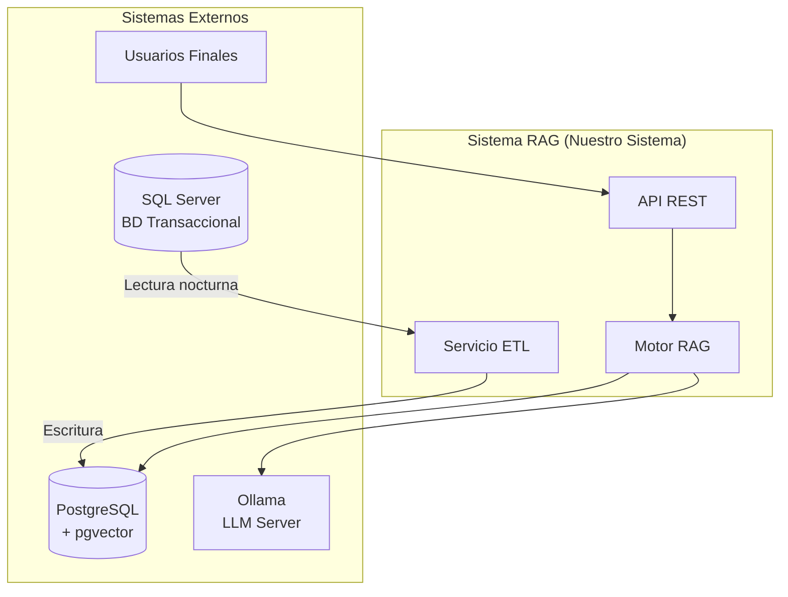
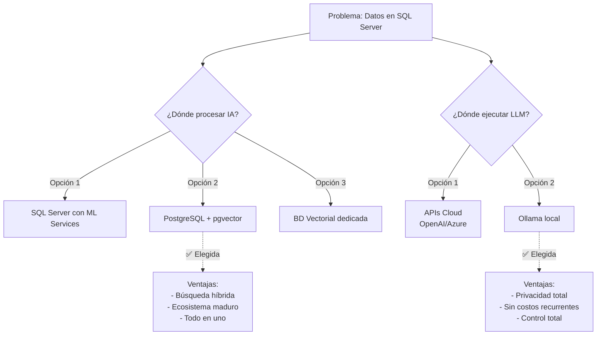
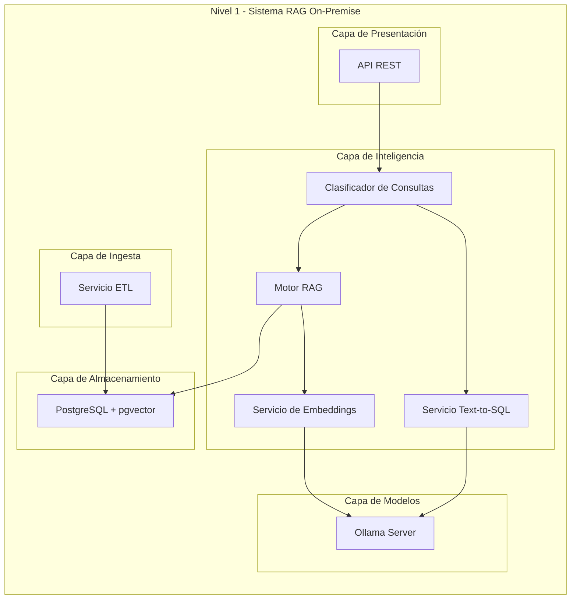
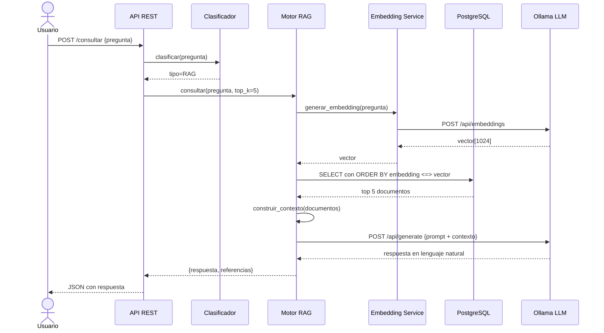
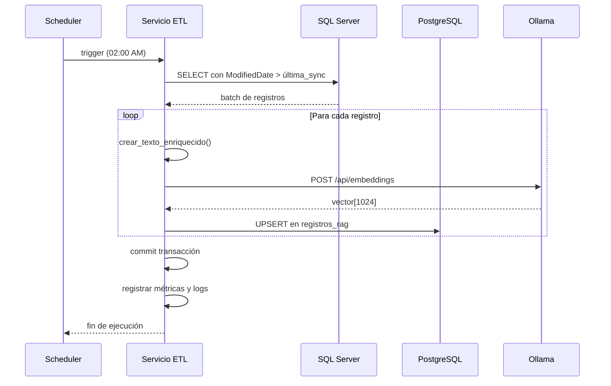
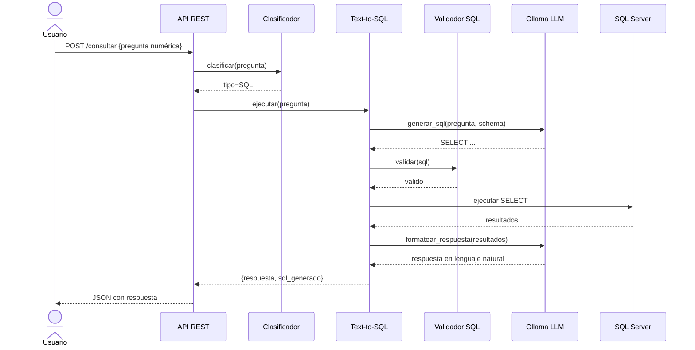
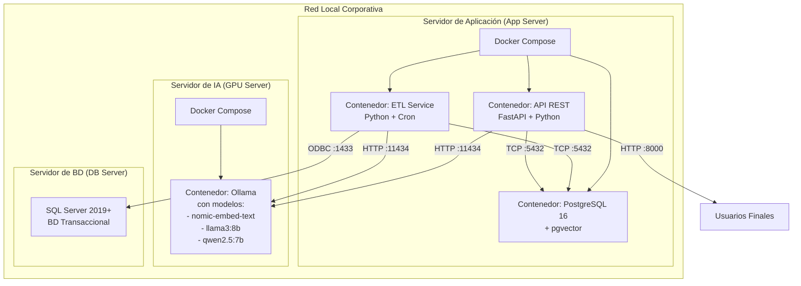
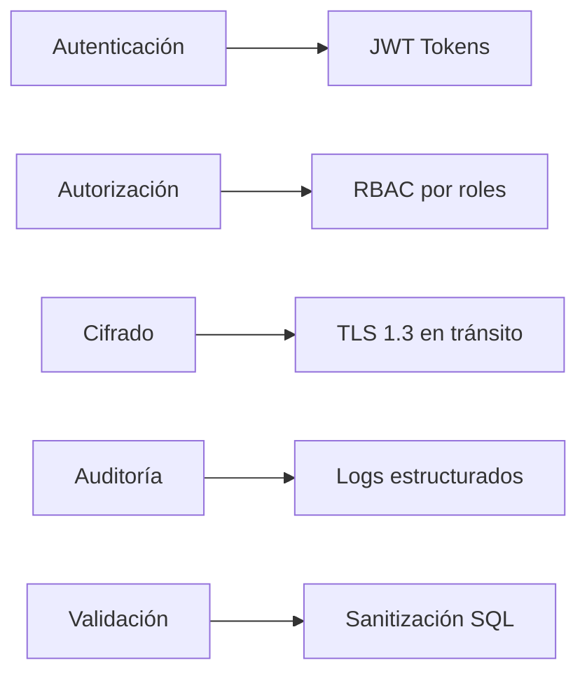
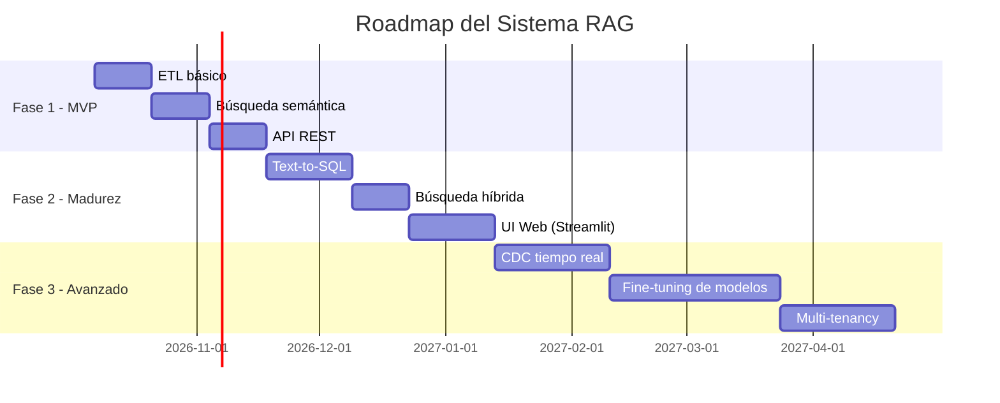

---

# 🏗️ ARTEFACTO 2: Software Architecture Document (SAD)

## Sistema RAG On-Premise para Consultas Semánticas

---

# Documento de Arquitectura de Software (SAD)

**Proyecto:** Sistema de Consultas Semánticas y RAG On-Premise  
**Versión:** 1.0  
**Fecha:** 01 de Octubre de 2026  
**Estilo arquitectónico:** Basado en el framework **arc42**  
**Autor:** Equipo de Arquitectura

---

## Tabla de Contenidos

1. [Introducción y Objetivos](#1-introducción-y-objetivos)
2. [Restricciones](#2-restricciones)
3. [Contexto y Alcance](#3-contexto-y-alcance)
4. [Estrategia de Solución](#4-estrategia-de-solución)
5. [Vista de Bloques (Descomposición)](#5-vista-de-bloques)
6. [Vista de Ejecución](#6-vista-de-ejecución)
7. [Vista de Despliegue](#7-vista-de-despliegue)
8. [Conceptos Transversales](#8-conceptos-transversales)
9. [Decisiones de Arquitectura (ADRs)](#9-decisiones-de-arquitectura)
10. [Riesgos y Deuda Técnica](#10-riesgos-y-deuda-técnica)
11. [Glosario](#11-glosario)

---

## 1. Introducción y Objetivos

### 1.1 Introducción

Este documento describe la arquitectura del **Sistema de Consultas Semánticas y RAG On-Premise**, que provee capacidades de IA sobre datos transaccionales de SQL Server, manteniendo todos los datos dentro de la infraestructura local de la organización.

### 1.2 Objetivos de Calidad (Quality Goals)

| # | Objetivo | Escenario | Prioridad |
|---|----------|-----------|-----------|
| OQ-01 | **Privacidad** | Ningún dato sale de la red local bajo ninguna circunstancia. | Crítica |
| OQ-02 | **Respuesta rápida** | El 95% de las consultas se responden en < 15 segundos. | Alta |
| OQ-03 | **Disponibilidad** | El sistema está operativo 99.5% en horario laboral. | Alta |
| OQ-04 | **Precisión semántica** | Los resultados recuperados son relevantes en > 85% de los casos. | Alta |
| OQ-05 | **Mantenibilidad** | Nuevas tablas de SQL Server se integran en < 1 día de trabajo. | Media |
| OQ-06 | **Escalabilidad** | Soportar 10M de vectores sin degradación significativa. | Media |

### 1.3 Stakeholders

| Rol | Expectativa |
|-----|-------------|
| **Usuarios de negocio** | Consultar datos en lenguaje natural, obtener respuestas precisas. |
| **TI / Operaciones** | Sistema estable, monitoreable, fácil de operar. |
| **Seguridad / Cumplimiento** | Datos sensibles protegidos, auditoría completa. |
| **Desarrolladores** | API clara, documentación, facilidad de integración. |
| **Dirección** | ROI claro, costos controlados (sin APIs en la nube). |

---

## 2. Restricciones

### 2.1 Restricciones Técnicas

| ID | Restricción | Justificación |
|----|-------------|---------------|
| TC-01 | **On-Premise obligatorio** | Política de seguridad corporativa para datos financieros. |
| TC-02 | **SQL Server como fuente** | Sistema transaccional existente, no se puede reemplazar. |
| TC-03 | **PostgreSQL como BD vectorial** | Elección estratégica por madurez de pgvector. |
| TC-04 | **Ollama como runtime de modelos** | Open source, soporta múltiples modelos, fácil de operar. |
| TC-05 | **Python como lenguaje principal** | Ecosistema maduro para IA (LangChain, LlamaIndex). |

### 2.2 Restricciones Organizacionales

| ID | Restricción | Justificación |
|----|-------------|---------------|
| OC-01 | **Presupuesto limitado** | No se pueden contratar servicios cloud de IA. |
| OC-02 | **Equipo pequeño** | 2-3 desarrolladores + 1 DBA. |
| OC-03 | **Ventana nocturna** | ETL solo puede ejecutarse entre 02:00 y 06:00 AM. |

### 2.3 Convenciones

- **Idioma del código:** Inglés (variables, funciones, clases).
- **Idioma de datos y respuestas:** Español.
- **Estilo de código:** PEP 8 para Python.
- **Control de versiones:** Git con flujo GitLab Flow.
- **Formato de documentación:** Markdown.

---

## 3. Contexto y Alcance

### 3.1 Contexto Técnico



### 3.2 Contexto de Negocio

| Elemento | Descripción |
|----------|-------------|
| **Sistemas upstream** | SQL Server con datos de socios y créditos. |
| **Sistemas downstream** | Aplicaciones web/móviles que consumen la API. |
| **Usuarios** | Analistas, ejecutivos, oficiales de crédito. |
| **Datos manejados** | Información personal y financiera de socios. |

---

## 4. Estrategia de Solución

### 4.1 Enfoque Arquitectónico

Se adopta una **arquitectura en capas con patrón Pipeline** para el procesamiento RAG, y un **patrón Batch/Scheduler** para la sincronización de datos.

**Principios de diseño:**

1. **Separación de responsabilidades:** Cada componente tiene una única responsabilidad clara.
2. **Bajo acoplamiento:** Los componentes se comunican mediante interfaces bien definidas.
3. **Tolerancia a fallos:** El sistema se degrada gracefully si un componente falla.
4. **Configuración externa:** Todos los parámetros críticos son configurables.
5. **Observabilidad:** Logs, métricas y trazas en todos los componentes.

### 4.2 Decisiones de Diseño Clave



---

## 5. Vista de Bloques

### 5.1 Descomposición de Nivel 1 (Contexto)



### 5.2 Descomposición de Nivel 2 (Detalle de Componentes)

#### 5.2.1 Servicio ETL

| Responsabilidad | Detalles |
|-----------------|----------|
| **Propósito** | Sincronizar datos de SQL Server a PostgreSQL cada noche. |
| **Responsabilidades** | - Extraer datos de SQL Server.<br>- Transformar a texto enriquecido.<br>- Generar embeddings.<br>- Cargar en PostgreSQL (UPSERT).<br>- Manejar errores y reintentos. |
| **Interfaces** | - Lee de SQL Server vía ODBC.<br>- Escribe en PostgreSQL vía psycopg2.<br>- Llama a Ollama vía HTTP. |

#### 5.2.2 Motor RAG

| Responsabilidad | Detalles |
|-----------------|----------|
| **Propósito** | Orquestar el pipeline de retrieval + generation. |
| **Responsabilidades** | - Recibir pregunta.<br>- Coordinar embedding, búsqueda y generación.<br>- Construir prompts.<br>- Formatear respuesta final. |
| **Interfaces** | - Entrada: pregunta + parámetros.<br>- Salida: respuesta + referencias. |

#### 5.2.3 Clasificador de Consultas

| Responsabilidad | Detalles |
|-----------------|----------|
| **Propósito** | Determinar si una pregunta requiere RAG o Text-to-SQL. |
| **Responsabilidades** | - Analizar la pregunta.<br>- Clasificar en categorías.<br>- Enrutar al motor adecuado. |
| **Implementación** | LLM pequeño (ej. `qwen2.5:3b`) con prompt de clasificación. |

### 5.3 Paquete de Código (Nivel 3)

```
rag-system/
├── src/
│   ├── etl/
│   │   ├── extractor.py          # Extracción desde SQL Server
│   │   ├── transformer.py        # Generación de texto enriquecido
│   │   ├── loader.py             # Carga en PostgreSQL
│   │   └── scheduler.py          # Programación nocturna
│   │
│   ├── core/
│   │   ├── embedding_service.py  # Servicio de embeddings (Ollama)
│   │   ├── vector_searcher.py    # Búsqueda en pgvector
│   │   ├── llm_service.py        # Llamadas a LLM
│   │   └── rag_engine.py         # Motor RAG principal
│   │
│   ├── sql/
│   │   ├── text_to_sql.py        # Generación de SQL
│   │   ├── sql_validator.py      # Validación de seguridad
│   │   └── sql_executor.py       # Ejecución contra SQL Server
│   │
│   ├── classifier/
│   │   └── query_classifier.py   # Clasificador de tipo de consulta
│   │
│   ├── api/
│   │   ├── main.py               # FastAPI app
│   │   ├── routes.py             # Endpoints
│   │   ├── schemas.py            # Pydantic models
│   │   └── middleware.py         # Auth, logging, etc.
│   │
│   └── common/
│       ├── config.py             # Configuración centralizada
│       ├── logging.py            # Logging estructurado
│       └── exceptions.py         # Excepciones personalizadas
│
├── tests/
├── docker/
│   ├── docker-compose.yml
│   └── Dockerfile.*
├── docs/
└── README.md
```

---

## 6. Vista de Ejecución

### 6.1 Runtime: Consulta RAG



### 6.2 Runtime: ETL Nocturno



### 6.3 Runtime: Text-to-SQL



---

## 7. Vista de Despliegue

### 7.1 Topología Física



### 7.2 Mapeo de Componentes a Nodos

| Componente | Nodo | Puerto | Protocolo |
|------------|------|--------|-----------|
| API REST | App Server | 8000 | HTTPS |
| ETL Service | App Server | N/A (cron) | N/A |
| PostgreSQL | App Server | 5432 | TCP |
| Ollama | GPU Server | 11434 | HTTP |
| SQL Server | DB Server | 1433 | TCP |

### 7.3 Requisitos de Hardware

| Servidor | CPU | RAM | GPU | Almacenamiento |
|----------|-----|-----|-----|----------------|
| **App Server** | 8 cores | 32 GB | No requerida | 500 GB SSD |
| **GPU Server** | 8 cores | 64 GB | NVIDIA RTX 4090 (24GB) o A100 | 1 TB SSD |
| **DB Server** | 16 cores | 128 GB | No requerida | 2 TB SSD |

> **Nota:** En ausencia de GPU, Ollama puede correr en CPU, pero los tiempos de respuesta serán 5-10x mayores.

### 7.4 Canal de Comunicación

| De → A | Canal | Seguridad |
|--------|-------|-----------|
| Usuario → API | HTTPS | TLS 1.3 |
| API → PostgreSQL | TCP local | Sin cifrado (red interna) |
| API → Ollama | HTTP local | Sin cifrado (red interna) |
| ETL → SQL Server | TDS/ODBC | TLS recomendado |
| ETL → PostgreSQL | TCP local | Sin cifrado (red interna) |

---

## 8. Conceptos Transversales

### 8.1 Seguridad



**Políticas:**
- Todas las APIs requieren autenticación JWT.
- Roles: `admin`, `analyst`, `readonly`.
- Los logs de auditoría son inmutables y se retienen 1 año.
- El Text-to-SQL solo permite SELECT; cualquier otra operación es rechazada.

### 8.2 Manejo de Errores

| Nivel | Estrategia |
|-------|-----------|
| **API** | Retornos HTTP estándar (400, 401, 404, 500) con mensajes claros. |
| **Motor RAG** | Si el LLM falla, devolver solo los documentos recuperados. |
| **ETL** | Transaccional: rollback completo si falla. Reintentos con backoff exponencial. |
| **Ollama** | Circuit breaker: si falla 3 veces, se deshabilita temporalmente. |

### 8.3 Observabilidad

**Métricas (Prometheus):**
- `rag_query_duration_seconds` (histograma)
- `rag_embedding_duration_seconds`
- `rag_llm_generation_duration_seconds`
- `etl_records_processed_total`
- `etl_errors_total`

**Logs (JSON estructurado):**
```json
{
  "timestamp": "2026-10-01T09:15:30Z",
  "level": "INFO",
  "service": "rag-api",
  "trace_id": "abc123",
  "user_id": "user_42",
  "event": "query_completed",
  "duration_ms": 3420,
  "documents_retrieved": 5
}
```

**Trazas distribuidas:** OpenTelemetry para correlacionar requests a través de componentes.

### 8.4 Persistencia

| Dato | Almacenamiento | Retención |
|------|----------------|-----------|
| Vectores y metadatos | PostgreSQL | Indefinida |
| Logs de auditoría | PostgreSQL (tabla `audit_log`) | 1 año |
| Métricas | Prometheus + Grafana | 30 días |
| Backups PostgreSQL | Dump diario + WAL | 30 días |

### 8.5 Configuración

Todas las configuraciones se gestionan vía variables de entorno o archivos `.env`:

```env
# Base de datos
POSTGRES_HOST=localhost
POSTGRES_PORT=5432
POSTGRES_DB=rag_db
POSTGRES_USER=postgres
POSTGRES_PASSWORD=***

SQL_SERVER_HOST=sqlsrv.corp
SQL_SERVER_PORT=1433
SQL_SERVER_DB=produccion

# Modelos
OLLAMA_URL=http://gpu-server:11434
EMBEDDING_MODEL=nomic-embed-text
LLM_MODEL=llama3:8b
CLASSIFIER_MODEL=qwen2.5:3b

# Parámetros RAG
TOP_K_DEFAULT=5
SIMILARITY_THRESHOLD=0.7
MAX_CONTEXT_TOKENS=4000

# ETL
ETL_SCHEDULE=0 2 * * *  # 2:00 AM diario
ETL_BATCH_SIZE=100
```

---

## 9. Decisiones de Arquitectura (ADRs)

### ADR-001: PostgreSQL + pgvector como BD Vectorial

- **Contexto:** Necesitamos almacenar y buscar vectores de embeddings.
- **Opciones consideradas:**
  1. Pinecone (SaaS)
  2. Milvus (dedicada)
  3. **PostgreSQL + pgvector** ✅
  4. Qdrant
- **Decisión:** PostgreSQL + pgvector.
- **Justificación:**
  - Permite búsqueda híbrida (vectorial + texto) en una sola consulta.
  - Evita sincronizar IDs entre múltiples BDs.
  - Ecosistema maduro y bien soportado por LangChain/LlamaIndex.
  - On-premise sin dependencias externas.
- **Consecuencias:** Necesitamos mantener PostgreSQL actualizado (v16+).

### ADR-002: Ollama como Runtime de Modelos

- **Contexto:** Necesitamos ejecutar LLMs y modelos de embedding localmente.
- **Opciones consideradas:**
  1. vLLM
  2. **Ollama** ✅
  3. LM Studio
  4. Llama.cpp directo
- **Decisión:** Ollama.
- **Justificación:**
  - API REST simple y bien documentada.
  - Soporta múltiples modelos simultáneamente.
  - Fácil instalación y operación.
  - Comunidad activa.
- **Consecuencias:** Dependemos de la disponibilidad de modelos en el registry de Ollama.

### ADR-003: Sincronización Nocturna Batch (vs CDC en Tiempo Real)

- **Contexto:** Necesitamos mantener PostgreSQL sincronizado con SQL Server.
- **Opciones consideradas:**
  1. **Batch nocturno** ✅
  2. CDC con Kafka
  3. Triggers en SQL Server
  4. API de escritura dual
- **Decisión:** Batch nocturno.
- **Justificación:**
  - Simplicidad de implementación.
  - Cero impacto en SQL Server durante horario laboral.
  - Suficiente para el caso de uso (datos de socios/créditos no requieren tiempo real).
  - Fácil de monitorear y auditar.
- **Consecuencias:** Latencia de hasta 24 horas en la disponibilidad de nuevos datos.
- **Evolutivo:** Si se requiere tiempo real, se puede migrar a CDC en una fase 2.

### ADR-004: Sistema Híbrido RAG + Text-to-SQL

- **Contexto:** Los usuarios hacen tanto preguntas exploratorias como numéricas exactas.
- **Opciones consideradas:**
  1. Solo RAG
  2. Solo Text-to-SQL
  3. **Híbrido con clasificador** ✅
- **Decisión:** Sistema híbrido con clasificador automático.
- **Justificación:**
  - RAG es excelente para consultas semánticas/ambiguas.
  - Text-to-SQL es preciso para consultas numéricas.
  - El clasificador enruta automáticamente al motor correcto.
- **Consecuencias:** Mayor complejidad, pero mejor experiencia de usuario.

### ADR-005: Texto Enriquecido como Estrategia de Vectorización

- **Contexto:** Los datos tabulares (socios, créditos) no son texto natural.
- **Opciones consideradas:**
  1. Vectorizar campos crudos concatenados
  2. **Texto enriquecido con mapeo semántico** ✅
  3. Múltiples vectores por registro
- **Decisión:** Texto enriquecido.
- **Justificación:**
  - Los códigos (`GASTOS_MEDICOS`) se traducen a descripciones semánticas.
  - Mejora drásticamente la recuperación.
  - Un solo vector por registro simplifica la búsqueda.
- **Consecuencias:** Requiere mantener un diccionario de mapeos.

### ADR-006: FastAPI como Framework de API

- **Contexto:** Necesitamos exponer la funcionalidad vía API REST.
- **Opciones consideradas:**
  1. Flask
  2. **FastAPI** ✅
  3. Django REST Framework
- **Decisión:** FastAPI.
- **Justificación:**
  - Asíncrono por diseño (ideal para llamadas a LLM).
  - Validación automática con Pydantic.
  - Documentación OpenAPI automática.
  - Rendimiento superior.
- **Consecuencias:** Equipo necesita conocer async/await en Python.

---

## 10. Riesgos y Deuda Técnica

### 10.1 Riesgos

| ID | Riesgo | Probabilidad | Impacto | Mitigación |
|----|--------|--------------|---------|------------|
| R-01 | El hardware GPU no es suficiente para la carga | Media | Alto | Pruebas de carga antes de producción. Plan de escalamiento vertical. |
| R-02 | Los modelos locales no tienen calidad suficiente en español | Media | Alto | Evaluar múltiples modelos (Qwen2.5, Llama3). Fine-tuning si es necesario. |
| R-03 | El ETL nocturno excede la ventana de mantenimiento | Baja | Medio | Procesamiento incremental. Monitoreo de duración. |
| R-04 | Alucinaciones del LLM generan respuestas incorrectas | Alta | Alto | Prompt engineering estricto. Umbral de similitud alto. Mostrar fuentes. |
| R-05 | Inyección SQL vía Text-to-SQL | Media | Crítico | Validador SQL con whitelist de operaciones. Solo SELECT permitido. |
| R-06 | Crecimiento descontrolado del tamaño de la BD vectorial | Media | Medio | Política de retención. Archivado de registros antiguos. |

### 10.2 Deuda Técnica Identificada

| Deuda | Impacto | Plan de Resolución |
|-------|---------|---------------------|
| Falta de pruebas de integración end-to-end | Medio | Implementar en Sprint 3. |
| Documentación de API limitada | Bajo | OpenAPI auto-generado por FastAPI. |
| Falta de UI para usuarios no-técnicos | Alto | Evaluar Open WebUI o Streamlit en Fase 2. |
| Monitoreo básico | Medio | Implementar Prometheus + Grafana en Sprint 2. |

### 10.3 Evolución Futura (Roadmap)



---

## 11. Glosario

| Término | Definición |
|---------|-----------|
| **ADR** | Architecture Decision Record. Documento que captura una decisión arquitectónica importante. |
| **Pipeline** | Secuencia de procesamiento donde la salida de una etapa es la entrada de la siguiente. |
| **Circuit Breaker** | Patrón que previene llamadas repetidas a un servicio fallido. |
| **Graceful Degradation** | Capacidad del sistema de mantener funcionalidad parcial ante fallos. |
| **RTO** | Recovery Time Objective. Tiempo máximo aceptable de indisponibilidad. |
| **RPO** | Recovery Point Objective. Pérdida máxima de datos aceptable. |
| **Backoff exponencial** | Estrategia de reintentos con tiempos de espera crecientes. |
| **Whitelist** | Lista de elementos permitidos; todo lo demás se rechaza. |

---

## 📌 Resumen Ejecutivo

Este SAD describe un sistema RAG **on-premise**, **seguro** y **escalable** que:

✅ **Respeta la privacidad** al mantener todos los datos dentro de la red local.  
✅ **Aprovecha la infraestructura existente** (SQL Server) sin modificarla.  
✅ **Utiliza PostgreSQL + pgvector** como columna vertebral para búsqueda híbrida.  
✅ **Ejecuta modelos de IA localmente** con Ollama, sin costos de APIs en la nube.  
✅ **Combina RAG + Text-to-SQL** para cubrir todos los tipos de consultas.  
✅ **Es evolutivo**, permitiendo migrar a CDC en tiempo real cuando sea necesario.

Los **ADRs documentados** justifican cada decisión clave y facilitan el onboarding de nuevos miembros del equipo, mientras que los **riesgos identificados** permiten una gestión proactiva durante la implementación.

---